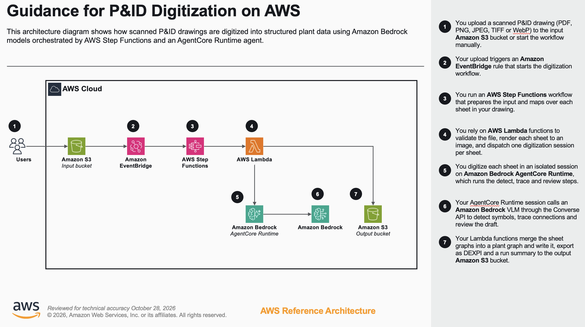

# Guidance for P&ID Digitization on AWS

Turn scanned or PDF Piping and Instrumentation Diagrams (P&IDs) into structured data: every
equipment item, valve, instrument, fitting and line number on a sheet, the pipes and signal lines
between them, and a plant graph with a DEXPI export. Each sheet is digitized by an Amazon Bedrock
model in three steps: detect, trace, then an agent that reviews its own result.

## Table of Contents

- [Overview](#overview)
- [Architecture](#architecture)
- [Accuracy and model choice](#accuracy-and-model-choice)
- [Cost](#cost)
- [Prerequisites](#prerequisites)
- [Deploy](#deploy)
- [Run](#run)
- [Outputs](#outputs)
- [Run locally](#run-locally)
- [Documentation](#documentation)
- [Cleanup](#cleanup)
- [Notices](#notices)

## Overview

For each sheet, one Bedrock model does all the work:

1. **Detect.** The sheet is cut into overlapping tiles near the model's native image resolution.
   Each tile lists every symbol and label with a bounding box. The tiles are then merged and
   de-duplicated, and each item gets an id.
2. **Trace.** The model gets the full sheet, a copy with every item boxed and labelled, and the
   item list. It traces every pipe, signal and impulse line as a polyline through the items it
   passes, and records the line number printed along each one.
3. **Review.** A [Strands](https://strandsagents.com) agent zooms into regions of the original
   sheet with its draft drawn on top. It adds, corrects and deletes items and lines until the
   draft matches the drawing. Graph rule violations found in the draft (for example a valve with
   only one connection, or a pipe that ends nowhere) are passed to it as hints.

The result is then built into a sheet graph, using the same convention for every sheet: a node per
physical item, with pipes cut at every inline item and at every tee. The graph is checked against
the same rules and exported as DEXPI-style Proteus XML. Sheets of one drawing set are stitched into
a plant graph through off-page connectors and shared equipment tags.

This replaces version 1 of this Guidance, which combined three separate components: a trained
symbol detector on a SageMaker endpoint, Bedrock Data Automation for OCR, and OpenCV line
detection. The new approach needs no training data and no always-on endpoint. You can still get the
v1 code and model from the [v1.0.0 release](https://github.com/aws-solutions-library-samples/guidance-for-piping-and-instrumentation-diagrams-digitization-on-aws/releases/tag/v1.0.0).

## Architecture



1. A drawing (PDF, PNG, JPEG, TIFF or WebP) arrives in the input bucket. An upload under
   `drawings/` starts the workflow through EventBridge, or you can start it yourself.
2. **PrepareInput** (Lambda) checks the file, merges any per-run settings over the deployed
   defaults, and writes one PNG per sheet. PDF pages are rendered at 300 dpi by default.
3. A **Map** state handles the sheets in parallel, up to `maxConcurrentSheets` at a time. For each
   sheet, **DispatchSheet** (Lambda) starts an
   [Amazon Bedrock AgentCore Runtime](https://docs.aws.amazon.com/bedrock-agentcore/latest/devguide/agents-tools-runtime.html)
   session and returns within seconds. Step Functions then waits on a task token, and nothing is
   billed for compute while it waits.
4. The **AgentCore Runtime** session digitizes the sheet in the background:
   - it runs the detect, trace and review steps against Amazon Bedrock and writes every
     intermediate result to S3;
   - it sends a heartbeat every minute;
   - when it finishes, it resumes the workflow with `SendTaskSuccess`, or with `SendTaskFailure`
     if the sheet fails.

   Each sheet runs in its own isolated microVM, and a session can run for up to 8 hours. The agent
   is deployed as a zip file, so no container image is needed.
5. **MergeSheets** (Lambda) stitches the sheet graphs into a plant graph. It writes the plant
   graph, the remaining rule violations, a DEXPI export, and a `summary.json` with per-sheet
   status, token usage and cost.

**Network.** The Lambdas and the agent runtime run in a private VPC that the stack creates. The VPC
has no internet gateway and no NAT gateway. AWS APIs are reached only through VPC endpoints: an S3
gateway endpoint plus interface endpoints for Bedrock Runtime, Bedrock AgentCore, Step Functions
and CloudWatch Logs. VPC flow logs are turned on. You can use an existing VPC instead (see
[Configuration](docs/CONFIGURATION.md#vpc-and-endpoints-networking)).

If a sheet fails with a throttling or model error, or the agent stops sending heartbeats, that
sheet is retried in a new session. The retry reuses the detect and trace results already saved in
S3. A sheet that still fails is marked failed in `summary.json`, and the other sheets still
complete.

## Accuracy and model choice

The digitizer runs on any vision model on Amazon Bedrock that supports the Converse API. The
deployment allows OpenAI GPT on Bedrock (GPT-6.1 Sol, GPT-6.1 Terra, GPT-6 Astra) and Anthropic
Claude (Sonnet 5.5, Opus 5.5). The default is **GPT-6.1 Sol**. You can change the model per
deployment or per run (see [Configuration](docs/CONFIGURATION.md)).

The benchmark below covers 10 real-world sheets: `1`, `10`, `100`–`107` from the Digitize-PID dataset
(S. Paliwal, A. Jain, M. Sharma, L. Vig, *Digitize-PID: Automatic Digitization of Piping and
Instrumentation Diagrams*, PAKDD 2021, [arXiv:2109.03794](https://arxiv.org/abs/2109.03794)). Each
model ran once per sheet with detect, trace and review. The sheets are not redistributed here; get
them from the authors' release.

| Model | Label accuracy (F1) | Valve tags P / R | Instruments P / R | Line numbers P / R | Connections P / R | Connections F1 | Cost per sheet | Time per sheet |
|---|---|---|---|---|---|---|---|---|
| GPT-6.1 Sol (default) | **99%** | 99% / 99% | 97% / 96% | 99% / 99% | 90% / 88% | **89%** | $1.24 | 5.8 min |
| GPT-6.1 Terra | **99%** | 100% / 99% | 100% / 95% | 100% / 100% | 86% / 88% | 87% | **$0.55** | **3.0 min** |
| GPT-6 Astra | **99%** | 100% / 99% | 99% / 93% | 100% / 100% | 93% / 89% | **91%** | $6.79 | 5.3 min |
| Claude Sonnet 5.5 | **99%** | 100% / 99% | 95% / 97% | 97% / 100% | 84% / 79% | 81% | $1.39 | 5.3 min |
| Claude Opus 5.5 | 96% | 100% / 98% | 85% / 86% | 100% / 100% | 88% / 85% | 87% | $3.31 | 5.4 min |

- **P (precision)** is the share of reported items that are correct. **R (recall)** is the share of
  items on the sheet that were found. Counts are pooled over all 10 sheets before P, R and F1 are
  computed.
- **Label accuracy** is the F1 score over valve tags, instruments and line numbers together. Valve
  tags and line numbers must match the printed string exactly. Instruments are matched by position,
  and every printed token must be present.
- **Connections** compares the links between components, with pipes folded in, against a
  connection key. The keys were generated from the dataset's ground truth; on sheet 1 the generated
  key was checked against a hand-made one.
- **Cost** uses on-demand list prices, with no discounts.

Every model labels almost everything correctly. The models differ mainly in how well they trace
connections, and in cost. Astra traces best at about 5× the cost of Sol. Terra costs less than
half as much as Sol for slightly weaker tracing.

Results on your drawings will differ. Before you choose a model, score a few of your own sheets
with the local scorer (see [Run locally](#run-locally)).

## Cost

You are responsible for the cost of the AWS services used while running this Guidance. There is
no always-on compute. A deployment costs about **$60 a month** even when idle:

- $58 for the four interface VPC endpoints, in two Availability Zones at $0.01 per hour each;
- $2 for the two KMS keys;
- a few cents for S3 storage and flow logs.

Almost all of the cost per sheet is model tokens. The rest is small:

| Service | Usage per sheet | Cost per sheet (USD) |
|---|---|---|
| Amazon Bedrock (GPT-6.1 Sol) | about 760,000 input tokens (mostly cached images) and 22,000 output tokens per benchmark sheet | about $1.24 |
| Bedrock AgentCore Runtime | one session of a few minutes, billed for active CPU and memory | under $0.01 |
| AWS Step Functions (Standard) | about 10 state transitions | under $0.001 |
| AWS Lambda | three short invocations | under $0.001 |
| Amazon S3 | about 20 objects, a few MB | under $0.001 |

For 100 dense sheets a month, that is about **$125 with GPT-6.1 Sol** or about **$55 with
GPT-6.1 Terra**, plus the $60 fixed cost. If you deploy into an existing VPC that already has these
endpoints, the fixed cost drops to about $2. Version 1 cost about $879 a month for its inference
endpoint alone. Sparse sheets use fewer tiles and tokens. Turning off the review
step (`review.enabled: false`) or lowering `review.maxViews` cuts tokens, at some loss of accuracy.

Prices are US East (N. Virginia) on-demand list prices on 2026-10-08 and will change. See
[Amazon Bedrock pricing](https://aws.amazon.com/bedrock/pricing/) and
[AgentCore pricing](https://aws.amazon.com/bedrock/agentcore/pricing/).

## Prerequisites

- An AWS account, with credentials that can deploy CDK stacks.
- Access to the Bedrock model you want to use, in your deployment Region. Third-party models can
  need a one-time offer acceptance. See
  [model access](https://docs.aws.amazon.com/bedrock/latest/userguide/model-access.html).
- A Region where Bedrock AgentCore Runtime and your model's inference profile are available.
  The defaults use the `us.` cross-Region profiles.
- Node.js 20+ and the AWS CDK CLI (`npm install -g aws-cdk`).
- [uv](https://docs.astral.sh/uv/) to bundle the Python code as Linux arm64 packages. If uv is not
  installed, CDK falls back to Docker.
- Python 3.12+ (only to run the digitizer or the tests locally).

## Deploy

```bash
git clone https://github.com/aws-solutions-library-samples/guidance-for-piping-and-instrumentation-diagrams-digitization-on-aws.git
cd guidance-for-piping-and-instrumentation-diagrams-digitization-on-aws/cdk
npm install
cdk bootstrap        # once per account and Region
cdk deploy --all
```

This deploys two stacks: `PNIDDigitization-Network` (VPC, subnets, endpoints) and `PNIDDigitization`
(buckets, agent runtime, Lambdas, workflow). Set `CDK_STACK_NAME` to use another name prefix.

The defaults work without a config file: GPT-6.1 Sol, review on, upload trigger on for the
`drawings/` prefix, 4 sheets at a time, and a new isolated VPC. To change any of them, copy
`config.json.template` to `config.json` and edit it. See [Configuration](docs/CONFIGURATION.md),
which also covers deploying into an existing VPC.

The stack outputs include the bucket names, the state machine ARN and a ready-made usage hint.

## Run

**Upload a drawing:**

```bash
aws s3 cp plant-area-1.pdf s3://<InputBucketName>/drawings/
```

**Or start a run yourself.** This also lets you change settings for that one run:

```bash
aws stepfunctions start-execution \
  --state-machine-arn <StateMachineArn> \
  --name area-1-astra \
  --input '{"bucket": "<InputBucketName>", "key": "drawings/plant-area-1.pdf",
            "config": {"modelId": "us.openai.gpt-6-astra", "review": {"maxViews": 60}}}'
```

You can follow progress in the Step Functions console. Each sheet appears as one Map iteration,
and the agent's logs are in CloudWatch under `/aws/bedrock-agentcore/runtimes/`.

**Try it with the sample:**

```bash
aws s3 cp ../samples/synthetic_pid_1001.png s3://<InputBucketName>/drawings/
```

## Outputs

Everything for a run goes under `s3://<OutputBucketName>/<execution name>/`:

```
<execution name>/
├── input.json                 source file, merged config, page list
├── pages/<sheet>.png          one image per sheet
├── sheets/<sheet>/
│   ├── sheet.json             digitized sheet: items, runs, connections, usage and cost
│   ├── graph.json             sheet graph
│   ├── issues.json            rule violations left after review
│   ├── dexpi.xml              DEXPI-style Proteus XML
│   ├── graph.dot              Graphviz view of the topology
│   ├── overlay.png            the result drawn over the sheet, for checking by eye
│   └── detect.json, trace.json, trace.raw.txt, draft.json, review.json   intermediate steps
├── plant.graph.json           all sheets stitched together
├── plant.issues.json
├── plant.dexpi.xml
├── plant.dot
└── summary.json               per-sheet status, token usage, cost
```

The formats are described in the [API reference](docs/API_REFERENCE.md). The DEXPI export follows
DEXPI 1.3 class names and the Proteus 4 layout. It has not been validated against the DEXPI XSD, so
check it with your target tool.

## Run locally

The digitizer is a plain Python package ([`pidtwin/`](pidtwin/)). It runs on a laptop with Bedrock
credentials, and the workflow is not needed:

```bash
cd pidtwin
python -m venv .venv && .venv/bin/pip install -e '.[digitize,pdf]'
.venv/bin/python -m pidtwin.digitize.pipeline ../samples/synthetic_pid_1001.png      # GPT-6.1 Sol
.venv/bin/pidtwin build results/synthetic_pid_1001.GPT-61_Sol.json
.venv/bin/pidtwin dexpi results/synthetic_pid_1001.GPT-61_Sol.graph.json
```

If a `<name>.truth.json` file sits next to the image, the pipeline scores the result against it.
`--models sol,terra,sonnet` (or `--models all`) compares several models in one go.

To run the unit tests:

```bash
.venv/bin/pip install -e '.[test]'
.venv/bin/python -m unittest discover tests
```

From `cdk/`, `npm test` type-checks the CDK app and runs the same tests.

## Documentation

- [How digitization works](docs/DIGITIZATION_PIPELINE.md): detect, trace and review stages; which steps are model calls
- [Configuration](docs/CONFIGURATION.md): deployment and per-run settings, choosing a model, networking
- [API reference](docs/API_REFERENCE.md): workflow input, Lambda and agent payloads, output formats, graph convention
- [Troubleshooting](docs/TROUBLESHOOTING.md): model access, throttling, timeouts, failed sheets
- [CDK stack](cdk/README.md): what the stack creates and how the code is packaged

## Cleanup

```bash
cd cdk
cdk destroy PNIDDigitization            # application: buckets (emptied), runtime, Lambdas, workflow
# wait until AgentCore has released its network interfaces (up to 8 hours), then:
cdk destroy PNIDDigitization-Network    # VPC, subnets, endpoints
```

The input and output buckets are emptied and deleted with the application stack, and so are its
log groups.

AgentCore can keep the runtime's network interfaces in the subnets for up to 8 hours after the
runtime is deleted. That is why the network is a separate stack. The application stack always
deletes cleanly, and the network stack can be deleted once the interfaces are gone. If you delete
it too early, it ends in `DELETE_FAILED`; run `cdk destroy PNIDDigitization-Network` again later.
To check whether the interfaces are gone:

```bash
aws ec2 describe-network-interfaces --filters Name=vpc-id,Values=<VpcId> Name=interface-type,Values=agentic_ai \
  --query 'length(NetworkInterfaces)'
```

CloudWatch log groups that AgentCore creates for the runtime
(`/aws/bedrock-agentcore/runtimes/...`) are not part of the stack. Delete them yourself if you no
longer need them:

```bash
aws logs describe-log-groups --log-group-name-prefix /aws/bedrock-agentcore/runtimes/ \
  --query 'logGroups[].logGroupName' --output text
aws logs delete-log-group --log-group-name <name>
```

## Notices

Customers are responsible for making their own independent assessment of the information in this Guidance. This Guidance: (a) is for informational purposes only, (b) represents AWS current product offerings and practices, which are subject to change without notice, and (c) does not create any commitments or assurances from AWS and its affiliates, suppliers or licensors. AWS products or services are provided “as is” without warranties, representations, or conditions of any kind, whether express or implied. AWS responsibilities and liabilities to its customers are controlled by AWS agreements, and this Guidance is not part of, nor does it modify, any agreement between AWS and its customers.

Model output can be wrong. Review digitized results before you rely on them for engineering,
safety or operational decisions.

## Contributing

See [CONTRIBUTING](CONTRIBUTING.md) and the [Code of Conduct](CODE_OF_CONDUCT.md). Report security
issues through [AWS vulnerability reporting](https://aws.amazon.com/security/vulnerability-reporting/),
not GitHub issues.

## License

This project is licensed under the MIT-0 License. See [LICENSE](LICENSE).
